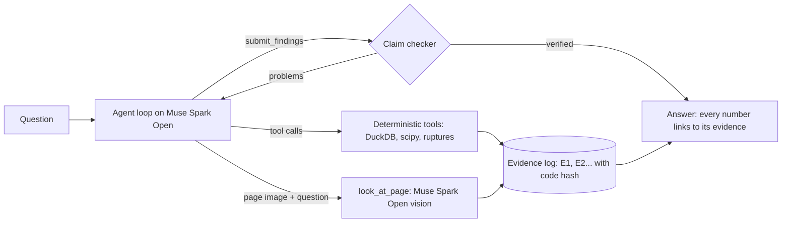

# WellPilot

An AI agent for production and reservoir engineers. Ask why a well changed; it works the answer out on the field's own data and reports, and every number, date and quote in its answer is checked against the tool result it came from before you see it.

It runs on **Muse Spark Open**, Meta's open-weight model, so an operator can host it next to well data that never leaves the company. This demo uses Equinor's open Volve field (Norwegian North Sea, 2008-2016).

**Try the time machine.** Set a past date and the agent answers as of that day, with no data after it. Then "Show what happened next" opens the rest. As of 2010-12-31 it picks F-12 as the well that needs attention first (a dead downhole gauge, a rate 55% lower since water broke through) and forecasts its 2011 oil; the reveal sets that forecast against what the well produced and against the textbook decline fit made the same day.

- Live demo: _link added at deploy_
- Demo video: _link added at submission_

Built for the Meta Global AI Developer Hackathon (Oct 26 - Nov 4, 2026), Indie track, "Push the Frontier".

## Things to try

- **The time machine.** The first example asks as of 2010-12-31; after the answer, "Show what happened next" sets its forecast against the year that followed.
- **Try to fool the checker.** Under any finished answer, change a finding (a number, a cause, the fact label, a well name, a quote) and press "Check again". The checker runs on the run's saved tool results, with no model involved, and says what it caught: "'1 815' is not in its source, E1. The closest values in that result are 1 551, ...".
- **Watch the forecasts in order.** On the Accuracy tab, a slider runs through every forecast made for F-12 (12 of them, 2009-2015) on fixed axes: the agent's window and forecast, the textbook fit's, and what the well then produced, with a running median error for both. It shows the December 2014 restart that no method saw.
- **Drag to ask.** Drag across a span on the well chart; a chip offers "Ask what happened to F-12 between ... and ...", which fills the ask bar with the dates.
- **See what was done to the wells.** Volve's daily drilling and well-work reports (819 of them for the seven producing wellbores) are parsed into jobs: the agent can call `well_operations`, the well charts mark each job, and the History tab replays the field screen at every month end with the work on one axis. On 2014-11-26 F-12 got a plug at 3150 m and a new zone perforated, and came back at about 840 Sm3/d of oil with a water cut of 0.22, after 176 Sm3/d at 0.97: the restart no forecast saw.
- **A second opinion.** After the checker accepts an answer, the same model reads it as a senior reservoir engineer and questions the reasoning, which the checker does not check. The agent gets one chance to settle the points with its tools; if its revision does not pass the checker, the checked answer stands.
- **The plan's curve, read off its picture.** The 2005 plan draws its expected oil rate only in a figure. SAM 3.1, Meta's segmentation model, finds the curve from the words "magenta line"; the axes are calibrated on the figure's gridlines, and a colour trace of the same pixels checks the reading. The Plan tab sets that curve against what the field produced: the plan drew a plateau near 8,500 Sm3/d until mid-2009, while its text says 9,000.
- **Ask by voice.** The microphone button records up to 15 seconds; the same open-weight model transcribes it (Muse Spark Open takes audio as it takes page images) and the question lands in the ask bar for you to check before sending.

## Who it is for

A production engineer reviewing a well asks questions like: why did output fall, is that a reservoir problem or a dead gauge, what will the well make next year, and how does it compare with the development plan? Answering one today means hours across a production database, PDF reports (here a 53-page plan in Norwegian), scripts and spreadsheets, and the result is hard to audit.

WellPilot turns that into one question, answered in under a minute (a median of 36 s and $0.15 of model time over the 12 eval questions; $0.06-0.48), where every figure links to the exact tool result, the data behind it and the Python that produced it. The decisions it supports are the everyday ones: next year's forecast for a budget, which wells need a gauge or a workover, and whether the field is running against the limits it was designed for.

## What it does

1. **Plans and runs real analysis.** The agent writes a short plan, then calls deterministic tools over the data: monthly production, event detection (regime changes, water-cut crossings, shut-ins, dead gauges), Arps decline fits and forecasts with ranges calibrated on past errors, waterflood diagnostics (WOR against cumulative oil, liquid and choke, injection support), a screen of every well, read-only SQL, arithmetic, a search of report facts, the field against the plan's forecast and design limits, and a look at a report page image when only the picture holds the answer.
2. **Starts from the whole field.** The first screen ranks every well by what needs attention on any date: a dead downhole gauge, water cut past the platform's design limit, a steep decline, long shut-ins, an abrupt step down in rate or a shift to a lower one.
3. **Checks itself before answering.** A deterministic checker reads the submitted answer. Every declared number must be in the evidence it cites, at the precision written, and be what the text says it is: the right well, the right quantity (not an uptime called a water cut), the right direction (not a fall called a rise) and the right event's date. Every quote must be there word for word; a finding that states a cause, or rests on a poor fit, must be marked an inference. Problems go back to the model, which fixes them and resubmits. The UI shows each round and what changed.
4. **Answers in plain words.** Each finding is one or two sentences with a few rounded numbers; the fit behind it (model, window, r2, decline rate) sits under "Details for engineers" and is checked the same way.
5. **Lets you trace every number.** Click a number in the answer to open the tool result with that value marked; click a Norwegian quote to see the plan page with the passage outlined; open the tool's source code, hashed at run time.

## What it found in Volve

From the recorded runs and the data tabs (all reproducible with the tools in this repo):

- **A dead gauge, not a collapsing reservoir.** F-12's downhole pressure reads 0 from 2010-10-12 to the end of the data: 2095 days, 1830 of them flowing and producing 1,133,053 Sm3 of oil. A naive reading is a pressure collapse; the agent rules it out.
- **Water broke through as the plan said.** The 2005 plan expects injection water to break through "etter omlag 2 år" (after about 2 years). F-12's water cut passed 5% on 2009-10-31, 20.6 months after first oil, and its oil rate moved from a plateau of 4,050 Sm3/d on average to 1,146 after 2010-07-18: a gradual shift as water took over (about 22% across the change itself), not a step.
- **The field reached its design water cut when the plan expected it to close.** The plan's facility limit is "Maksimum vannkutt 0,80". The field as a whole reached 0.80 in June 2012 and stayed at or above it for 27 months. It never ran over its capacities: liquid peaked at 11,438 Sm3/d against 13,000, and water at 10,240 Sm3/d on its worst day against the 10,400 the platform could handle (13,000 x 0.80).
- **Water, not pressure.** From 2010 to 2014 F-12's liquid rate held near 5,000 Sm3/d while its choke opened from about 53% to 100% and water cut rose from 0.57 to 0.96: the oil fell because water took the well's capacity. Injection replaced what was produced at reservoir conditions (a ratio of 1.0-1.1 every year with the plan's oil formation volume factor, 1.385), so pressure support held. With data to the end of 2012, the WOR trend left 165k Sm3 before a 0.90 water cut and 560k before 0.95; the well went on to make about 444k.
- **A report only a picture can answer.** F-11 B's completion report (filed under F-12 in the Volve data) keeps its survey tables and the completion's time-depth chart as images: the chart ends the job on 23.07.2013, and the production data shows F-11's first oil the next day.
- **The field outlived its plan.** The plan's P50 forecast was 11.34 million Sm3 by 2012. The field produced 10.04 million Sm3 by 2016, 2.48 million of it after the plan's last year, from wells drilled later (F-11, F-15 D, F-1 C) and an injector turned producer (F-5). The plan assumed first oil in March 2007 and the field started in February 2008, so year by year from each start: ahead in the first year (1.76 against 1.53 million Sm3), behind from the second.
- **What the agent would have said at the end of 2010.** With data cut at 2010-12-31 it ranked F-12 first (dead gauge, rate 55% lower since May 2010) and forecast 359k Sm3 of oil for 2011, with a range of 324k-470k from its past errors. F-12 then made 340k (+6%, inside the range). The textbook whole-history decline fit, made the same day, said 685k (+102%): it averages the plateau years in. The gauge never came back.

## How accurate are its forecasts?

A rolling backtest: for each producer, every 6 months, the data is cut at that day and the next 12 months of oil are forecast, then compared with what the well produced. The tools never return data after the cut. 25 forecasts in total (F-12, F-14, F-11).

| Method | Median error | Mean error | Off by more than 50% |
|---|---|---|---|
| WellPilot agent on Muse Spark Open, its own fit window | 13.8% | 19.9% | 2 |
| Decline fit, last 3 months (best fixed window, known only in hindsight) | 14.4% | 24.7% | 4 |
| Decline fit, last 24 months | 15.4% | 27.3% | 6 |
| Decline fit, last 6 months | 19.7% | 31.6% | 5 |
| Decline fit, last 12 months | 20.6% | 28.1% | 6 |
| Decline fit, whole history (textbook default) | 27.6% | 39.5% | 8 |

The fair comparison is the best fixed window: the agent is about even with it on the median (closer in 15 of 25), with a lower mean error and fewer large misses, while nobody could have picked that window in advance. Against the textbook whole-history fit it halves the median error and is closer in 17 of 25. These are 25 overlapping forecasts from three wells of one field: a check, not a benchmark, and too few for a significance claim. The agent's two large misses are F-12 on either side of its December 2014 restart, which no method saw coming.

Each case scores the forecast the agent's answer cites. Agents often try several windows and answer with one; in 10 of the 25 runs that is not their last forecast call. Scoring the last call instead gives a median of 14.3% and three large misses.

Uncertainty: a range from the fit's scatter (bootstrap) held the actual volume in 40% of the agent's forecasts. Each forecast also reports a range built from the errors of forecasts made the same way from earlier dates; it held the actual in 76% (13 of 17 forecasts with enough history), against an 80% goal. Each forecast also gives the P50 of every Arps model, since the choice of model can matter as much as the data.

Arps fits keep b at most 1 (harmonic): a waterflooded conventional well in boundary-dominated flow does not decline with b above 1, and letting b run to 2 made short windows overstate the tail. All 25 agent runs were made with Muse Spark Open on Baseten (23 verified by the checker; 2.4M input and 0.19M output tokens, about $3.80 in total); the table refits each with the window and model the agent chose.

## How it works



- **Data:** Volve daily production (xlsx) is cleaned into Parquet: zeros in pressure and temperature columns become missing, 228 days absent from the sheet are restored as zero-production days, and every change is logged. The 2005 development plan (PDF, Norwegian) is rendered page by page to PNG plus text. At ingest Muse Spark Open reads every page image and extracts structured facts with verbatim quotes; a deterministic review then checks each page the way the agent's answers are checked (quotes not on the page word for word, numbers no fact covers, a page of text with no facts) and sends the problems back until the model fixes them. Result: 512 facts, 507 quotes verbatim on the page, none unverified; each quote is located on the page image.
- **Reports:** the 2005 development plan (Norwegian, 53 pages) and F-11 B's final well report on its completion (English, 64 pages, 28 of them pictures: survey tables, a time-depth chart, a wellhead schematic). Pages that are pictures are marked at render time; their facts carry 'image' quotes, and the agent can read them itself with `look_at_page`.
- **Tools** (`backend/src/wellpilot/agent/tools.py`, `vision.py`): `list_wells`, `production_monthly`, `detect_events`, `fit_decline`, `forecast_production`, `waterflood`, `field_screen`, `run_sql` (one read-only SELECT, sandboxed), `calculate`, `search_reports`, `read_report_page`, `plan_vs_actual`, `field_vs_design`, `look_at_page`. Each successful call becomes evidence with its arguments, result, warnings and a hash of the tool's source.
- **Checker** (`backend/src/wellpilot/agent/checker.py`): numbers are declared by the model (`{text, value, evidence_id}`) rather than parsed from prose; English and Norwegian number formats, unit scales and dates written in words are handled. It is tested with property-based fuzzing over 10 number formats, a corpus of real submissions replayed in CI, and a table of probes for false rejections and false passes.
- A number the text ties to a date ("0.85 in 2009-06", "55% on 2010-05-02") must stand in that date's row or event. A number found in its evidence must not be held there only for another well, as another quantity, or with the opposite sign; a "from X to Y" must run the way the evidence's change does.
- **What the checker does not check:** meaning. "Pressure collapsed to 0" would pass when the evidence says the gauge reads 0; whether the reasoning holds is for the reader, and that is why every number is one click from its source.
- **Quality gates:** `python -m wellpilot.ingest.facts_gate` (free) checks the report facts: the plan's table rows, the design limits, the key quotes verbatim, no unverified quote, quotes located on their pages. `python -m wellpilot.eval` runs 12 real questions through the agent and checks each answer: verified, the right tools called, the facts any correct answer contains, claims in plain words, a step and cost budget. Latest runs (Oct 27, Muse Spark Open): all 12 answers verified; 6 pass every check, the others go over a step or cost budget or write a claim with more than four numbers.
- **Backend:** Python 3.13, FastAPI, Server-Sent Events, DuckDB, pandas, scipy, ruptures, pypdfium2. Runs are background tasks saved as JSON and replayable. 430 tests, including three featured runs replayed in CI.
- **Frontend:** React, TypeScript, Vite, uPlot, hand-written SVG charts. A control-room palette after ISA-101: grey by default, colour only for meaning (oil green, water blue, amber caution, red alarm).

## Running it on another field

The analysis tools, the agent loop, the checker and the UI work on any daily production table with the same columns (date, well, hours on stream, oil, water, gas, water injected, downhole and wellhead pressure, choke). What is specific to Volve:

- the ingest's column map and cleaning rules (`backend/src/wellpilot/ingest/production.py`): another source needs its own map, and its own quirks (units, monthly data, how missing values are written);
- the report registry (`backend/src/wellpilot/ingest/reports.py`) and the two plan tools, which parse this plan's production table and design limits (`plan_vs_actual`, `field_vs_design` in `agent/tools.py`), and the plan's oil formation volume factor used for voidage (`analysis/waterflood.py`);
- one line of the system prompt naming the field (`agent/loop.py`).

**Tested on a synthetic field.** `python -m wellpilot.synthetic` writes six wells (2015-2020) with planted events through the same ingest, and records what was planted; `DATA_DIR=data/synthetic` points the app, the agent and the eval at it. On five questions the agent named every planted cause: a dead downhole gauge on its day, a step down that was a choke cut (operations, not the reservoir), a well depleting with no water (pressure 280 to 150 bar), and a faster decline after an injector stopped. Its 12-month forecast from after the choke cut came within 5% of the outcome (the whole-history fit: +25%). It also showed a weakness, now fixed: the regime-change detector found steps in smooth declines and overstated real steps (-65% for a planted -40%), and the agent repeated those as facts, which the checker cannot catch because they are in the evidence. A change point now has to leave the smooth Arps curve around it, and each one reports the change across it (4 weeks each side, -41% for the planted -40%) next to the change between the periods. Rerun on the fixed detector, the agent called P-3 and P-4 healthy, with stable declines, measured the choke cut as 41% across the change, and forecast P-2 within 5% again (its band from past errors held).

## Meta models

- **Muse Spark Open** (`meta-models/muse-spark-open-1026` on Baseten) is the agent: tool calling with parallel calls, structured submissions, and its visible reasoning streamed to the UI per step. It also reads report page images during a run (`look_at_page`, JSON-schema output).
- **Muse Spark Open also reads every report page at ingest**, both documents, (vision plus JSON-schema output), corrected by the review rounds above. So the whole pipeline, ingest, agent and backtest, runs on the open-weight model. Muse Spark on the Meta Model API is a drop-in alternative: the same OpenAI-compatible client serves both providers and `LLM_PROVIDER` switches them.
- **SAM 3.1** (Meta Model API) reads the plan's forecast curve off Figure 4.2: one segmentation call with a text prompt, its mask decoded with Meta's `meta-sam-parser` (`backend/src/wellpilot/ingest/figure.py`). Muse Spark Open also takes the engineer's question by voice (`/api/transcribe`), and on each accepted answer gives a second opinion on the reasoning.
- Why open weights matter here: production data and well reports are an operator's most guarded data. An open-weight model can run on the operator's own hardware with this same code.

## Built during the hackathon

Everything in this repository was built during the hackathon, starting from the first commit on Oct 26, 2026: the data ingest and cleaning, the analysis tools, the agent loop, the claim checker and its tests, the backtest, the API and the web app. No code was carried over from earlier projects. Third-party open-source libraries are listed in `backend/pyproject.toml` and `frontend/package.json`.

## Data

Contains data from the Volve field dataset, made available by Equinor and the former Volve license partners (ExxonMobil Exploration & Production Norway AS, Bayerngas Norge AS) under the [Equinor Open Data Licence](https://www.equinor.com/content/dam/statoil/documents/what-we-do/Equinor-HRS-Terms-and-conditions-for-licence-to-data-Volve.pdf). The data is provided "as is". The data stays under that licence, not under this repository's code license. This project is not affiliated with or endorsed by Equinor or the Volve license partners.

Dataset page: https://www.equinor.com/energy/volve-data-sharing

## Development

Requirements: Python 3.13, [uv](https://docs.astral.sh/uv/), Node.js, pnpm.

```bash
cp .env.example .env                   # fill in the API keys
git config core.hooksPath .githooks    # scan for secrets before each commit (needs gitleaks)

cd backend
uv sync
uv run uvicorn wellpilot.main:app --reload   # API on :8000

cd frontend
pnpm install
pnpm dev                                     # UI on :5173, proxies /api to :8000
```

Data: download these files from the Volve dataset:
- `Production_data/Volve production data.xlsx` into `data/raw/production/`;
- `Reports/Volve PUD .pdf` into `data/raw/reports/Volve_PUD.pdf`;
- `Well_logs/14.DIV. REPORTS/15_9-F-12/COMPLETION_REPORT_3.PDF` (F-11 B's completion report) into `data/raw/reports/F11B_Completion_FWR.pdf`.

Then build the processed data:

```bash
cd backend
uv run python -m wellpilot.ingest.production     # cleaned production Parquet
uv run python -m wellpilot.ingest.reports        # report pages as PNG + text
uv run python -m wellpilot.ingest.report_facts   # facts read by Muse Spark (calls the LLM)
```

Tests and lint:

```bash
cd backend && uv run pytest && uv run ruff check .
cd frontend && pnpm lint && pnpm build
```

## Deploy

One Docker image: the API serves the built frontend and the processed data, so the app runs as one process on one machine (runs, the token budget and the rate limits live in its memory). The configuration targets [Fly.io](https://fly.io).

Build and smoke-test the image locally first. No API key goes in, so no tokens are spent:

```bash
docker build -t wellpilot:smoke .
scripts/smoke_image.sh
```

The image is built from the repository root and copies `data/processed`, so run the ingest first; the featured runs it replays come from `backend/tests/fixtures/runs`. Then, once:

```bash
brew install flyctl
fly auth login
fly launch --copy-config --no-deploy        # creates the app; it may pick another name
fly secrets set BASETEN_API_KEY=...          # the model key, never committed
fly secrets set OPERATOR_KEY=$(openssl rand -hex 24)   # lifts the public limits for you
fly secrets set FEATURED_RUNS=8aef8d548380,e51eada95269,3fc72959335a   # the runs the public site lists and replays
fly deploy
```

In the browser console of the deployed site, `localStorage.operatorKey = '<the operator key>'` lets your own runs skip the per-visitor and daily limits.

Public limits (settings in `backend/src/wellpilot/config.py`, overridable with Fly secrets): 3 runs at once, 6 runs per visitor per hour, 3M tokens per day, 600 s per run, 14 steps per run. Agent-written SQL is checked before it runs, and the list of runs shows only `FEATURED_RUNS`.

## License

Code: [MIT](LICENSE). Volve data: the Equinor Open Data Licence, see [Data](#data). The `meta-sam-parser` dependency is Meta's, under the SAM License; its text ships with the package (`meta_sam_parser-*.dist-info/licenses/LICENSE`) and so inside the Docker image.
