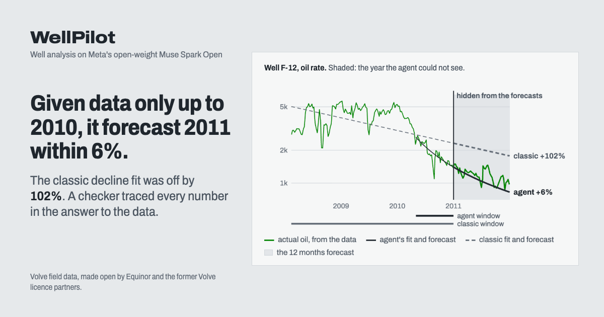
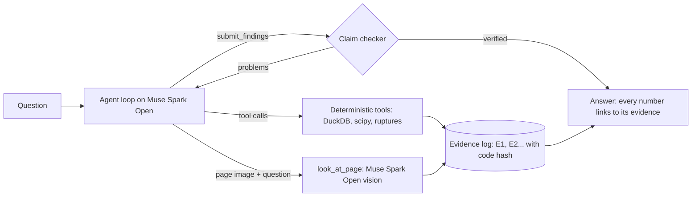

# WellPilot

**Ask why an oil well changed. An AI agent works it out from the field's own data and reports, and a checker sends its answer back until every number, date and quote is found in the tool result it cites.**



Oil wells produce less over time, and engineers have to tell why (the reservoir running out, water flooding in, a broken sensor, work done on the well) and what comes next. Today that takes an engineer one to two working days across production databases, PDF reports and spreadsheets (our estimate, set against what operators have published; no one has timed it yet). WellPilot answers in about a minute, on Meta's open-weight model Muse Spark Open, and every number in its answer links to the data and the code that produced it.

Why it matters: engineers spend up to 30% of their time searching for data and about as much again getting it into shape ([IPTC 12035](https://www.earthdoc.org/content/papers/10.3997/2214-4609-pdb.148.iptc12035)), and one large operator found spreadsheet work took as much as 70% of its production engineers' time ([Hart Energy](https://hartenergy.com/ep/exclusives/lets-give-production-engineers-break-21562)). A problem found late costs production: unplanned deferment at one Omani field was 3.7% of its potential against 1% for the industry's best ([SPE-214005-MS](https://squ.elsevierpure.com/ar/publications/excelling-in-subsurface-unscheduled-deferment-showcasing-best-in-)). And engineers check AI by hand: in a 2026 survey of 400 engineers, 86% used AI and 6% trusted its results without checking ([Omni Calculator](https://allwork.space/2026/02/86-of-u-s-engineers-use-ai-but-only-6-fully-trust-it-2026-survey-finds/)). WellPilot does the data work and the checking. Sources and caveats: [docs/impact-evidence.md](docs/impact-evidence.md).

- Live demo: https://wellpilot.fly.dev (recorded answers open without a key; live questions are rate-limited)
- Demo video: _link added at submission_

Built for the Meta Global AI Developer Hackathon (Oct 26 - Nov 4, 2026), Indie track, "Push the Frontier". The data is Equinor's open Volve field (Norwegian North Sea, 2008-2016).

## The story in five steps

1. **Go back to the end of 2010.** The first example asks the agent which wells need attention, with the data cut at 2010-12-31: it cannot see anything later.
2. **It finds F-12, and a broken sensor rather than a dying reservoir.** F-12's downhole pressure reads zero from 2010-10-12 while its oil and water flow on: the gauge died, not the reservoir. Its oil rate averaged 55% less after May 2010 than before (21% across the change itself), and that change was a choke-back: after four days fully open, the choke was cut over the last week of April to about 60% (from about 83% to 58% in the four weeks either side) while the water cut stayed near 0.46 and the downhole pressure rose, and the agent notes the choke cut. Water had broken through the winter before, about two years after first oil, as the 2005 development plan expected.
3. **It forecasts 2011 from the change it found.** It dates F-12's shift to 2010-05-02 itself and fits the decline only after it: 359,000 m³ of oil (about 2.3 million barrels), with a range from its own past errors. "Show what happened next": F-12 made 340,000 (+6%, inside the range). Fits made the same day on fixed windows said +2% to +24%; the agent's window came from the data, not from hindsight.
4. **Click any number.** It opens the exact tool result it came from, the value marked, with the Python that produced it.
5. **Try to fool the checker.** Change a number, a unit, a date, the direction of a change, the well, a quote, or add a cause: the checker sends it back, citing the source. It checks that every number, date and quote is where the answer says it is, not that the reasoning is right, and some lies still get through (how it is tested, and what passes, under "How it works").

The app tells the same story in five steps across its top: ask as of 2010, watch it work, the answer, what happened next, try to fool it. Any step opens on its own, and each has an address: `?step=4` opens what happened next on the recorded run.

## A decision, not only a diagnosis

The second recorded example asks, as of 2014-10-31, what to do with F-12 (water cut 0.97, 175 Sm³/d of oil, choke fully open). From the well's daily reports and its production logs the agent found that the 2010 plug at 3,210 m already shuts off everything below it, so every gap at or below it would cut nothing new; that the last log was 1,500 days old (water cut 0.63 then, 0.97 now); and that a plug in the only gap left, the blank pipe at 3,147-3,161 m, would on that log cut about 81% of the oil as well as 98% of the water. It advised keeping the well flowing and running a new log before any job. It also reckoned a plug alone would leave about 33-44 Sm³/d, which is today's rate times the share kept: a rough inference that ignores how the other zones respond once the water stops. Its forecast for the year (about 49,600 m³ if nothing is done) is marked an inference: a forecast describes what has not happened yet.

An earlier recording of this question read those shares the wrong way round: 81% of the oil kept, not cut. The checker passed it, since the number was in its source; a simulated reviewer caught it. The tool now also states what a plug keeps, and the agent now writes both.

Three weeks later the operator set its plug in that same gap, at 3,150 m, and perforated 3126.2-3130.7 m just above the top zone, which the answer had not proposed. "Show what happened next" sets the plug against the same 2010 log (below 96-100% of the water and 73-81% of the oil still flowing). The plug cut most of the logged oil too, and the operator perforated a new zone above it; no log after the job shows where the oil came from. The well came back at a water cut of 0.34 and 857 Sm³/d of oil (from 0.97 and 177, the 60 days either side), on a choke of about 33% at about 61 bar at the wellhead: a rate the operator set, not what the well could give. The whole field's water fell from about 9,100 to about 4,300 Sm³/d on the same days. Over the next year that was 125,000-145,000 m³ (0.8-0.9 million barrels) more oil than the well's decline, about $39-46 million of gross revenue at an assumed $50 a barrel, before costs. From the job to the end of its life the well made 248,000 m³ in all (a total, not the gain). Volumes are allocated from well tests.

We knew this job while building the agent, so this is a demonstration, not a blind test. Of 14 recorded answers to this question, the early ones gave other depths or none; the last 5 named this gap, after the production-log tool began marking what the 2010 plug already isolates, a rule that holds on its own physics.

So the 2010 log, read the way the agent read it, called the outcome: on that log a plug at the operator's 3,150 m leaves a flow of about 0-19% water (its two passes), and the well came back at 34%, low against the 97% before (the passes ran at a quarter and half of the well's rate, so the log is a guide, not a measurement). The agent found the gap the operator used and why the 2010 plug could not be repeated, and warned what a plug there costs in oil, but it asked for a newer log first and did not propose the new zone above. Its 33-44 Sm³/d for a plug alone is far from the 857 Sm³/d the whole job gave: the operator's judgment, not the agent's, made that job pay. An earlier recording of this question picked the gap the 2010 plug already sat in; the tool now marks gaps below a plug already in the hole, and the second opinion is shown the plugs in the hole. The agent could not see the job or its result (data and reports stop at its date).

## Could the model just remember Volve?

Volve is a public dataset, and a model may have read about it. Three things keep the time machine honest:

- **The tools never return data after the chosen date** (tested), and a question asked as of a past date does not name the field or its operator in the prompt. Well names and the 2005 plan would still identify it to a model that knows Volve well.
- **We asked the model what it remembers**, with no tools and no data (`python -m wellpilot.memory_probe`, Muse Spark Open, Oct 28; answers in [docs/evidence](docs/evidence)). Allowed to say it did not know, it declined every question about F-12. Made to guess (`--guess`), it got each one wrong, one in the wrong direction; only the field's end, widely published, it knew:

  | Question | The model's guess, from memory | The data |
  |---|---|---|
  | F-12's oil in 2011 | about 210,000 m³ | 340,000 m³ (the agent's forecast from the data: 359,000) |
  | F-12's downhole gauge in 2010 | drifted, failed around June | read zero from 2010-10-12 on |
  | Work on F-12 in November 2014, and after | a scale clean-out; a lower rate after | a plug at 3150 m and a new zone opened; oil from 180 to 860 m³/d |
  | F-12 at the end of 2012 | about 350 m³/d of oil, water cut 0.70 | 610 m³/d, water cut 0.88 |
  | When the field stopped, and its total | September 2016, about 10 million m³ | September 2016, 10.0 million m³ |

  The time machine asks about wells, not the field's end.
- **A field no model can have read about.** `python -m wellpilot.synthetic` generates six wells with known causes planted in them (a dead gauge, a choke cut, depletion, an injector stopping), run through the same ingest, tools and agent. The agent named every planted cause, and its 12-month forecast after the choke cut came within 5% of the outcome, where the textbook fit was 25% off.

## Terms

- **m³, Sm³/d:** oil and water in standard cubic metres (1 m³ is about 6.3 barrels), per day.
- **Water cut:** the share of water in the liquid a well produces; 0.80 means four parts water to one of oil.
- **Decline curve (Arps):** the textbook curve engineers fit to a well's falling rate to forecast it.
- **Production log (PLT):** a tool run down a flowing well that measures where along it the oil and the water come in.
- **Range (P90 to P10):** the low and high ends a forecast expects the outcome between, built from the errors of earlier forecasts made the same way (from five of them, it should hold about two times in three).

<details>
<summary><strong>More to try</strong>: the well along its depth, the model writing its own code, the plan's chart read by SAM 3.1, voice, and more</summary>

- **Try to fool the checker.** Under any finished answer, change a finding (a number, a cause, the fact label, a well name, a quote) and press "Check again". The checker runs on the run's saved tool results, with no model involved, and says what it caught: "'1 815' is not in its source, E1. The closest values in that result are 1 551, ...".
- **Watch the forecasts in order.** On the Accuracy tab, a slider runs through every forecast made for F-12 (12 of them, 2009-2015) on fixed axes: the agent's window and forecast, the textbook fit's, and what the well then produced, with a running median error for both. It shows the December 2014 restart that no method saw.
- **Drag to ask.** Drag across a span on the well chart; a chip offers "Ask what happened to F-12 between ... and ...", which fills the ask bar with the dates.
- **See what was done to the wells.** Volve's daily drilling and well-work reports (819 of them for the seven producing wellbores) are parsed into jobs: the agent can call `well_operations`, the well charts mark each job, and the History tab replays the field screen at every month end with the work on one axis. On 2014-11-26 F-12 got a plug at 3150 m and a new zone perforated, and came back at 857 Sm3/d of oil with a water cut of 0.34 (the 60 days from its return, 28 of them producing), after 177 Sm3/d at 0.97 in the 60 days before: the restart no forecast saw.
- **Look inside F-12.** The Inside tab puts the well along its depth: its two production logs, March 2009 and September 2010, as the share of oil and water coming from below each depth; the five perforated zones; the plugs set in 2010 at 3210 m and in 2014 at 3150 m; and what the well produced before and after each job (median water cut and oil rate per producing day over the 60 days before the job and the 60 days after the well came back, the same windows the agent and the reveal use). The 2009 log exists only as plots in its report, pictures with no numbers behind them, and was read off them (see below). Then oil came from all five zones and no water; by 2010 the lower zones gave water and almost no oil. The 2010 plug sat below about a third of the water (33% and 38% on the log's two flowing passes), and the water cut did not fall (0.64 to 0.68). The 2014 plug sat below all of it; with 3126.2-3130.7 m opened above it, the water cut fell from 0.97 to 0.34 and oil rose from 177 to 857 Sm3/d. The gain shrank but lasted: the monthly water cut was back to 0.50 by March 2015 and 0.80 by January 2016, and monthly oil fell to 386 Sm3/d by October 2015, still twice the 177 before the job; the well made 248,000 Sm3 of oil from the job to the end of its life. Its liquid stayed near 1,600 Sm3/d, a third of what it made before, even at full choke.
- **Let the model try to fool the checker.** Next to "Check again", "Let the model try" asks Muse Spark Open, the model whose answers the checker guards, to write false versions of the finding that read as naturally (a nudged number, another well's value, a moved date, a cause called a fact, a value from another row). Each goes through the same checker; the panel shows each attempt as a word diff, what the model says it made false, and whether it was caught. `python -m wellpilot.agent.redteam` does it for whole runs and reports the catch rate by kind of attack. Its first batch on the three featured runs wrote 36 false versions; the checker caught 30. Four of the six that got through were holes, now closed: a shut-in's date given as the gauge failure's, a peak tied to the wrong month, a "-22%" from another event passed off as "22 months", and a well's date given to the whole field. The other two changed only meaning or a quote's punctuation, which the checker does not judge. The same 36 now: 34 caught.
- **The agent writes its own code when no tool fits.** `run_python` runs the agent's Python in a Modal Sandbox: no network, a time and memory limit, and the field's tables cut at the question's date (the full copy is deleted before the code runs, so an answer about 2010 cannot read 2011). The code and what it returned are evidence like any tool's: click a number in the answer and the code that computed it opens beside its output. Numbers typed into the code are not evidence, and code that read no data is marked so nothing it returns can be stated as fact. At most four calls per question; errors come back with the agent's own lines, for it to fix.
- **Two Meta models on one picture.** When the agent asks Muse Spark Open to read the plan's forecast chart, each value it reads is set against SAM 3.1's measurement of the same pixels, within a quarter of a gridline fixed in advance (250 Sm3/d on a rate, 3 months on a length). The agent's tool result says only whether SAM agrees and by how much, so it cannot swap its reading for SAM's; the reader sees both, and if the agent writes a disputed value the checker's reply names SAM's measurement. When every figure reading on the page agrees with SAM, the picture's warning goes and a value both read can be stated as fact; while any reading disagrees, the page's readings stay inferences, and an answer may not write a disputed value as the figure's without saying SAM's measurement differs (the checker sends it back). The model reads the plateau rate within a gridline of SAM (8,400 against 8,464 Sm3/d) but keeps reading its length as about 2 years, against SAM's 19 months, which is what the plan's text says. The featured chart answer says so: about 8,500 Sm3/d for about 2 years, and that SAM's measurement differs at about 19 months. The LLM looks, SAM measures, deterministic code judges.
- **A second opinion.** After the checker accepts an answer, the same model reads it as a senior reservoir engineer and questions the reasoning, which the checker does not check. It is shown what the agent's own results recorded near the dates the answer names (a choke cut, a shut-in, a dead gauge, a job), so an explanation that skips one of them gets a point. The agent gets one chance to settle the points with its tools; if its revision does not pass the checker, the checked answer stands. On an earlier recording of the water shut-off question it raised three points (the 2014 gain could be the restart after the December shut-in or a flush; did it last?), and the agent checked and revised; on the three featured answers it read it found nothing to raise; the other three passed the checker too late in the run for it to read them.
- **The plan's curve, read off its picture.** The 2005 plan draws its expected oil rate only in a figure. SAM 3.1, Meta's segmentation model, finds the curve from the words "magenta line"; the axes are calibrated on the figure's gridlines, and a colour trace of the same pixels checks the reading. SAM's curve and the colour trace agree within 10 Sm3/d (median). The drawn plateau is 8,464 Sm3/d for 19 months (2008-03 to 2009-09): the 19 months the plan's text gives, and its 9,000 Sm3/d plateau rate times the 94% regularity it assumed for its profiles (8,460). The Plan tab sets that curve against what the field produced.
- **Ask by voice.** The microphone button records up to 15 seconds; the same open-weight model transcribes it (Muse Spark Open takes audio as it takes page images) and the question lands in the ask bar for you to check before sending. Tried live on Oct 28 with a synthesized spoken question: transcribed word for word, well name as "F-12", in 12 s and 890 tokens.

</details>

## Who it is for

A production engineer reviewing a well asks questions like: why did output fall, is that a reservoir problem or a dead gauge, what will the well make next year, and how does it compare with the development plan? Answering one today means working across a production database, PDF reports (here a 53-page plan in Norwegian), daily drilling reports, scripts and spreadsheets, and the result is hard to audit.

The decision with the most money in it is well work. F-12 had two water shut-offs: a plug set in 2010 that changed nothing (water cut 0.64 to 0.68 over the 60 days either side) and a plug and new perforations in 2014 that took oil from 177 to 857 Sm3/d, about 4,300 more barrels a day (the first weeks' daily volumes are allocated from a few well tests), and the gain shrank over the next 18 months: water cut 0.80 again by January 2016, and oil back near 190 Sm3/d by mid-2016. Why one worked and the other did not sits in a 2010 production log, a 2009 one that exists only as pictures, and 165 daily drilling reports; WellPilot reads all three and answers in under a minute, with each share tied to the depth and survey it comes from. Asked before the 2014 job, it read where the water entered but advised a new log first; the operator's bet on a new zone paid (see "A decision, not only a diagnosis" above).

The other buyer is whoever has to sign off on the numbers: reserves and surveillance reviews need to show where every figure came from. Every number here links to the tool result and the hashed code that produced it, so the audit trail comes with the answer.

The decisions it supports are the everyday ones: next year's forecast for a budget, which wells need a gauge or a workover, and whether the field is running against the limits it was designed for. An answer takes about a minute (on Oct 29, a median of 47 s and $0.32 of model time over the 15 eval questions, $0.09-0.60). Not every answer passes: 9 of the 15 were verified in the latest full run (see Quality gates).

Where it sits: decline-curve and surveillance software (OFM, Aries, PHDWin, a Spotfire dashboard) fits curves and plots the data an engineer picks; the engineer still reads the well-work reports and logs, decides what explains a change, and writes it up with sources. That is the part WellPilot does, on top of the same daily production export.

What one answer covers, counted from the data ([by hand vs with the agent](docs/by-hand-vs-agent.md)):

| Question | By hand | Estimated by hand | With the agent |
|---|---|---|---|
| Which wells need attention at the end of 2010, and next year's oil for the worst one | 4,544 daily rows, the 28 days of well-work reports since first oil (F-12 and F-14), the design limits in a 53-page Norwegian plan, decline fits on several windows and a range from earlier forecasts' errors | 7-13 h | 23 tool calls in about a minute, about $0.43, its numbers checked |
| What was done to F-12 in 2014, and why the 2010 plug did not work | 165 daily drilling reports, a production log in 3 digital passes and a 2009 one that exists only as pictures in a PDF | 7-15 h | 12 tool calls in 51 s, about $0.28 |

The hours are our estimate per step, not a timing: we found no published time study for these tasks. What operators and service companies have published sets the scale: an operator's routine review at 5-15 minutes per well per day and 50-100 wells per engineer (Arrow Energy, SPE workshop 2025), a well review for intervention candidates at 3 days per well (SLB with Pertamina, 2024), well models at 4-5 wells per engineer per day (ONGC, JPT 2026). The page above lists the steps, the sources and a protocol; timing one engineer on question 1 is the next measurement.

A pilot on another field: its daily production export mapped to these columns, a one-file field description (see "Running it on another field"), its well-work reports if it has them, and an engineer who answers the same questions by hand for a week so the times and the answers can be compared.

## What it does

1. **Plans and runs real analysis.** The agent writes a short plan, then calls deterministic tools over the data: monthly production, event detection (regime changes, water-cut crossings, shut-ins, dead gauges), Arps decline fits and forecasts with ranges calibrated on past errors, waterflood diagnostics (WOR against cumulative oil, liquid and choke, injection support), a screen of every well, read-only SQL, arithmetic, a search of report facts, the field against the plan's forecast and design limits, and a look at a report page image when only the picture holds the answer.
2. **Starts from the whole field.** The first screen ranks every well by what needs attention on any date: a dead downhole gauge, a water cut of 0.80 or more, a steep decline, long shut-ins, an abrupt step down in rate or a shift to a lower one.
3. **Checks itself before answering.** A deterministic checker reads the submitted answer. Every declared number must be in the evidence it cites, at the precision written, and be what the text says it is: the right well, the right quantity (not an uptime called a water cut), the right direction (not a fall called a rise) and the right event's date. Every quote must be there word for word; a finding that states a cause, or rests on a poor fit, must be marked an inference. Problems go back to the model, which fixes them and resubmits. The UI shows each round and what changed.
4. **Answers in plain words.** Each finding is one or two sentences with a few rounded numbers; the fit behind it (model, window, r2, decline rate) sits under "Details for engineers" and is checked the same way.
5. **Lets you trace every number.** Click a number in the answer to open the tool result with that value marked; click a Norwegian quote to see the plan page with the passage outlined; open the tool's source code, hashed at run time together with the analysis modules it calls, so a later change to the math shows as changed code.

## What it found in Volve

From the recorded runs and the data tabs (all reproducible with the tools in this repo):

- **The plan's figure says what its text means.** Read off Figure 4.2 by SAM 3.1, the plan's drawn plateau is 8,464 Sm3/d for 19 months; its text says "Platåraten på 9.000 Sm3/d vil vare om lag 19 måneder" (the plateau of 9,000 Sm3/d will last about 19 months) and that a regularity of 94% underlies its profiles: 9,000 x 0.94 = 8,460. The field itself peaked at 8,924 Sm3/d per calendar day in its best month.
- **Where F-12's water came from, from a log that was only a picture.** In March 2009, a year after first oil, a production log found oil coming from all five perforated zones, 10-17% of it from below 3200 m, and no water. That survey survives only as plots in its interpretation report; read off them by SAM 3.1, the upper two zones gave 83% of the oil at the high rate (0.829), where the report says "~83% of oil produced from the upper 2 completions". The September 2010 log (digital files) found the oil only between 3132 and 3165 m and the water below it, about a third of it below 3210 m. The bridge plug set at 3210 m the next day left the water cut where it was. The plug of November 2014 at 3150 m, below 97-100% of the 2010 water (and 73-81% of its oil), with a new zone opened just above the top one, took the water cut from 0.97 to 0.34.
- **A dead gauge, not a collapsing reservoir.** F-12's downhole pressure reads 0 from 2010-10-12 to the end of the data: 2095 days, 1830 of them flowing and producing 1,133,053 Sm3 of oil. A naive reading is a pressure collapse; the agent rules it out.
- **Water broke through when the plan said, though sooner by volume.** The 2005 plan expects injection water to break through "etter omlag 2 år" (after about 2 years), with about 6 MSm3 produced by then. F-12's water cut passed 5% on 2009-10-31, 20.6 months after first oil, but with the field at about 4.0 MSm3 (F-14 at 3.1 MSm3, in June 2009), and its oil rate moved from a plateau of 4,050 Sm3/d on average to 1,146 after 2010-07-18: a gradual shift as water took over (about 22% across the change itself), not a step.
- **The field reached its design water cut when the plan expected it to close.** The plan's facility limit is "Maksimum vannkutt 0,80". The field as a whole reached 0.80 in June 2012 and stayed at or above it for 27 months. Liquid and water handling never ran over, by month or by day: liquid peaked at 11,438 Sm3/d as a monthly average (12,756 on its highest day) against 13,000, and water at 10,240 Sm3/d on its worst day against the 10,400 the platform could handle (13,000 x 0.80). Oil and injection went over on single days: oil above its 9,000 Sm3/d capacity on 49 days in 2008-2009 (up to 9,437), though no month averaged over it; injection above its 16,000 Sm3/d capacity on 231 days, and as a monthly average in 3 months (up to 17,206 Sm3/d in December 2008).
- **Water, not pressure.** From 2010 to 2014 F-12's liquid rate held near 5,000 Sm3/d while its choke opened from about 53% to 100% and water cut rose from 0.57 to 0.96: consistent with water taking the well's capacity rather than the reservoir losing pressure. Injection replaced what was produced at reservoir conditions (a ratio of 1.0-1.1 every year with the plan's oil formation volume factor, 1.385), so pressure support held. With data to the end of 2012, the WOR trend left 165k Sm3 before a 0.90 water cut and 560k before 0.95. That overstated it: the well reached a 0.95 water cut in April 2014 after about 162k, and more than half of the 444k it made from 2013 on (248k) came after the November 2014 water shut-off, which no trend could see.
- **A report only a picture can answer.** F-11 B's completion report (filed under F-12 in the Volve data) keeps its survey tables and the completion's time-depth chart as images: the chart ends the job on 23.07.2013, and the production data shows F-11's first oil the next day.
- **The field outlived its plan.** The plan's P50 forecast was 11.34 million Sm3 by 2012. The field produced 10.04 million Sm3 by 2016, 2.48 million of it after the plan's last year, from wells drilled later (F-11, F-15 D, F-1 C) and an injector turned producer (F-5). The plan assumed first oil in March 2007 and the field started in February 2008, so year by year from each start: ahead in the first year (1.76 against 1.53 million Sm3), behind from the second.
- **What the agent would have said at the end of 2010.** With data cut at 2010-12-31 it ranked F-12 first (dead gauge; oil rate 55% lower on average after May 2010 than before, 21% across the change itself, when the choke was also cut from 83 to 58%), fitted the decline from the 2010-05-02 shift it had detected, and forecast 359k Sm3 of oil for 2011, with a range of 324k-470k from its past errors. F-12 then made 340k (+6%, inside the range), though for a mixed reason: the rate per producing day was 12% low (1,064 against 1,206 Sm3/d) and the time on stream 20% high (the fit window's 92% against 77% in 2011), and the two cancelled. Fits on fixed windows made the same day said +2% (last 12 months) to +24% (last 24 months): one did better, but which one was known only afterwards. The whole-history fit said 685k (+102%), since it averages the plateau years in. The gauge never came back.

## How accurate are its forecasts?

A rolling backtest: for each producer, every 6 months, the data is cut at that day and the next 12 months of oil are forecast, then compared with what the well produced. The tools never return data after the cut. 25 forecasts in total (F-12, F-14, F-11).

| Method | Median error | Mean error | Off by more than 50% |
|---|---|---|---|
| WellPilot agent on Muse Spark Open, its own fit window | 13.8% | 19.9% | 2 |
| Decline fit, last 3 months (best fixed window, known only in hindsight) | 14.4% | 24.7% | 4 |
| Decline fit, last 24 months | 15.4% | 27.3% | 6 |
| Decline fit, last 6 months | 19.7% | 31.6% | 5 |
| Decline fit, last 12 months | 20.6% | 28.1% | 6 |
| Decline fit, whole history (textbook default) | 27.6% | 39.5% | 8 |
| Rule, no model: fit after the last change point or well job | 21.2% | 28.7% | 5 |

The fair comparison is the best fixed window: the agent is about even with it on the median (closer in 15 of 25), with a lower mean error and fewer large misses, while nobody could have picked that window in advance. Against the textbook whole-history fit it halves the median error and is closer in 17 of 25. These are 25 overlapping forecasts from three wells of one field: a check, not a benchmark, and too few for a significance claim, and they were also the cases the method was developed on. The agent's large misses are all F-12: from 2013-08 (+69%), for a year that ended before the 2014 workover, when every method was 56-106% high because the well's decline steepened as its water cut passed 0.95; from 2014-02 and 2014-08 (-42%, -74%), across the restart after that workover, which no method saw coming; and from 2010-08 (-48%, where the last 12 months gave -19%).

The last row is the agent's own method written as a rule, with no model: fit from the later of the last detected change point and the last well-work job. The agent beats it on the median (14% against 21%) and on large misses (2 against 5), but is closer in only 12 of 25 cases: case by case they are even, and the model's reading of each well pays off where the rule picks a bad window.

Each case scores the forecast the agent's answer cites. Agents often try several windows and answer with one; in 10 of the 25 runs that is not their last forecast call. Scoring the last call instead gives a median of 14.3% and three large misses.

Uncertainty: a range from the fit's scatter (bootstrap) held the actual volume in 40% of the agent's forecasts. Each forecast also reports a range built from the errors of forecasts made the same way from earlier dates; it held the actual in 76% (13 of 17 forecasts with enough history). What such a range can promise depends on how many past forecasts it is built from: an 80% range from 5 past errors, as most of these have, covers about 67% (the forecast says so). The same kind of range on the last-3-months fit held in 89% of its 19 forecasts. Each forecast also gives the P50 of every Arps model, since the choice of model can matter as much as the data.

Arps fits keep b at most 1 (harmonic): a waterflooded conventional well in boundary-dominated flow does not decline with b above 1, and letting b run to 2 made short windows overstate the tail. All 25 agent runs were made with Muse Spark Open on Baseten (23 verified by the checker; 2.4M input and 0.19M output tokens, about $3.80 in total); the table refits each with the window and model the agent chose.

## How it works



- **Data:** Volve daily production (xlsx) is cleaned into Parquet: zeros in pressure and temperature columns become missing, 228 days absent from the sheet are restored as zero-production days, and every change is logged. The 2005 development plan (PDF, Norwegian) is rendered page by page to PNG plus text. At ingest Muse Spark Open reads every page image and extracts structured facts with verbatim quotes; a deterministic review then checks each page the way the agent's answers are checked (quotes not on the page word for word, numbers no fact covers, a page of text with no facts) and sends the problems back until the model fixes them. Result: 512 facts, 507 quotes verbatim on the page, none unverified; each quote is located on the page image.
- **Reports:** the 2005 development plan (Norwegian, 53 pages) and F-11 B's final well report on its completion (English, 64 pages, 28 of them pictures: survey tables, a time-depth chart, a wellhead schematic). Pages that are pictures are marked at render time; their facts carry 'image' quotes, and the agent can read them itself with `look_at_page`.
- **Tools** (`backend/src/wellpilot/agent/tools.py`, `vision.py`): `list_wells`, `production_monthly`, `detect_events`, `fit_decline`, `forecast_production`, `waterflood`, `field_screen`, `run_sql` (one read-only SELECT, sandboxed), `calculate`, `search_reports`, `read_report_page`, `plan_vs_actual`, `field_vs_design`, `well_operations`, `production_log`, `look_at_page`. Each successful call becomes evidence with its arguments, result, warnings and a hash of the tool's source and of the analysis modules it calls.
- **Checker** (`backend/src/wellpilot/agent/checker.py`): numbers are declared by the model (`{text, value, evidence_id}`) rather than parsed from prose; English and Norwegian number formats, unit scales and dates written in words are handled. It is tested five ways, all in CI except the two that call the model: property-based fuzzing over 10 number formats; a corpus of 349 real submissions replayed with their reviewed verdicts; metamorphic tests that reword every accepted answer in the corpus the way models vary their writing (typography, dates in words, "about", units, thousands separators: it must still pass) and break it in one checked way (a number, a date, a cause in a fact: it must fail); a paraphrase fuzzer (`python -m wellpilot.agent.paraphrase`) where Muse Spark Open writes true rewordings of the featured answers, 144 of them reviewed and pinned; and the red team, where it writes false ones. A false rejection used to surface only in a live run; the rewordings found nine before any run did. How often it catches a lie depends on who writes it: Muse Spark Open, attacking its own checker, wrote 90 false versions of the six featured answers and 73 were caught (most of the rest are off by less than 1% after "about", or take a value from elsewhere in a dense table). A simulated reviewer (an AI agent prompted to break it) wrote 158 edits by hand: of the 110 false ones within what the checker judges, 79 are caught and 31 still pass, listed in `backend/tests/fixtures/panel7_probes.json`; of 32 true ones, 30 pass. A second simulated reviewer (Oct 29) tried new kinds of edit: of its 131 false ones in scope, 90 are caught today and 41 pass (listed in its report: units and quantities named in other words, numbers swapped between two jobs, a hedge that covers a cause), and of 54 true ones 48 pass. A third swapped each declared number of the featured answers for another value of the same result it cites, as a model that copied the wrong cell would: 85 of 151 passed when it ran, 39 pass now. The same swap over every accepted answer in the corpus (`backend/tests/checker_bench.py`, 2,862 swaps, no model needed) went from 53% passing to 28% while none of 458 true rewordings is rejected; the checker now compares what the words around a number say it is (before or after a change, P10 or P90, a month or a year, a limit, its unit, a plug's depth or a gauge's) with the value it was taken from. About a third of what still passes has no words that tell the two values apart. A fourth (Oct 30) aimed 128 false edits at kinds the earlier ones had not tried: 60 passed (47%; a number from another quantity in the same sentence, a percentage that contradicts its own from-to, before and after swapped), and 6 of 48 true edits were sent back. These are hand-written attacks on likely holes, not a base rate. The latest full eval of the agent (Oct 29) predates the rules added since. So read the answer's check line ("every number, date and quote was found in the result it cites") as "every number was found where it says", not as "the reasoning is right".
- A number the text ties to a date ("0.85 in 2009-06", "55% on 2010-05-02") must stand in that date's row or event. A number found in its evidence must not be held there only for another well, as another quantity, or with the opposite sign; a "from X to Y" must run the way the evidence's change does.
- **What the checker does not check:** meaning in words. "Most" for "least", "deeper" for "shallower", or a sound number in a wrong argument would pass; whether the reasoning holds is for the reader, and that is why every number is one click from its source.
- **Quality gates:** `python -m wellpilot.ingest.facts_gate` (free) checks the report facts: the plan's table rows, the design limits, the key quotes verbatim, no unverified quote, quotes located on their pages. `python -m wellpilot.eval` runs 15 real questions through the agent and checks each answer: verified, the right tools called, the facts any correct answer contains, what a correct answer must not say (a pressure collapse where the gauge died, a level between periods called a jump, an economic verdict with no costs in the data), claims in plain words, a step and cost budget. Latest full run (Oct 31, Muse Spark Open): 9 of 15 verified, 6 pass every check. Four of the six unverified ended on false rejections by the checker, fixed since and not measured again in a full run; two were fair. On Oct 29, on a looser checker: 14 of 15 verified, 8 pass every check. It is still a small, single-shot set made of the questions the checker was developed on.
- **Backend:** Python 3.13, FastAPI, Server-Sent Events, DuckDB, pandas, scipy, ruptures, pypdfium2. Runs are background tasks saved as JSON and replayable. About 2,200 tests, including the featured runs replayed in CI.
- **Frontend:** React, TypeScript, Vite, uPlot, hand-written SVG charts. A control-room palette after ISA-101: grey by default, colour only for meaning (oil green, water blue, amber caution, red alarm). "Verified" is a check mark and words, never green, since green means oil. One more colour, indigo, marks only what you can act on and where you are (the step, the tab, buttons, links), far from water's blue.

## Running it on another field

The analysis tools, the agent loop, the checker and the UI work on any daily production table with the same columns (date, well, hours on stream, oil, water, gas, water injected, downhole and wellhead pressure, choke). What is specific to Volve:

- the ingest's column map and cleaning rules (`backend/src/wellpilot/ingest/production.py`): another source needs its own map, and its own quirks (units, monthly data, how missing values are written);
- the report registry (`backend/src/wellpilot/ingest/reports.py`) and the two plan tools, which parse this plan's production table and design limits (`plan_vs_actual`, `field_vs_design` in `agent/tools.py`), and the plan's oil formation volume factor used for voidage (`analysis/waterflood.py`);
- one line of the system prompt naming the field (`agent/loop.py`).

**Tested on a synthetic field.** `python -m wellpilot.synthetic` writes six wells (2015-2020) with planted events through the same ingest, and records what was planted; `DATA_DIR=data/synthetic` points the app, the agent and the eval at it. On five questions the agent named every planted cause: a dead downhole gauge on its day, a step down that was a choke cut (operations, not the reservoir), a well depleting with no water (pressure 280 to 150 bar), and a faster decline after an injector stopped. Its 12-month forecast from after the choke cut came within 5% of the outcome (the whole-history fit: +25%). It also showed a weakness, now fixed: the regime-change detector found steps in smooth declines and overstated real steps (-65% for a planted -40%), and the agent repeated those as facts, which the checker cannot catch because they are in the evidence. A change point now has to leave the smooth Arps curve around it, and each one reports the change across it (4 weeks each side, -41% for the planted -40%) next to the change between the periods. Rerun on the fixed detector, the agent called P-3 and P-4 healthy, with stable declines, measured the choke cut as 41% across the change, and forecast P-2 within 5% again (its band from past errors held).

## Meta models

- **Muse Spark Open** (`meta-models/muse-spark-open-1026` on Baseten) is the agent: tool calling with parallel calls, structured submissions, and its visible reasoning streamed to the UI per step. It also reads report page images during a run (`look_at_page`, JSON-schema output).
- **Muse Spark Open also reads every report page at ingest**, both documents, (vision plus JSON-schema output), corrected by the review rounds above. So the whole pipeline, ingest, agent and backtest, runs on the open-weight model. Muse Spark on the Meta Model API is a drop-in alternative: the same OpenAI-compatible client serves both providers and `LLM_PROVIDER` switches them.
- **Every answer says which Meta model did what**, in one line under its status, each with its evidence a click away.
- **SAM 3.1** (Meta Model API) checks Muse Spark Open's readings of the plan's chart against its own measurement of the same pixels (above), and reads pictures that hold numbers no file has: the plan's forecast curve off Figure 4.2 (`ingest/figure.py`), and F-12's production logs off their plots (`ingest/log_plots.py`): the 2009 survey, which exists only as pictures, and the 2010 one, whose digital files check the method (median gap about 1% of the flow at each depth). Each is a segmentation call with a few words ("magenta line", "green area", "cyan area", "black area"), its mask decoded with Meta's `meta-sam-parser`, the axes calibrated from marks found in the image, and a colour trace of the same pixels as a check. Where colour alone works, SAM is a second reading; where it cannot, SAM is the only one: on F-11 B's time-against-depth chart (`ingest/figure_bw.py`) the operations curve is black among black labels and markers, and a trace of dark pixels leaves the curve for the labels in 10% of the columns, while SAM's mask ("black plot line") follows it ([overlay](docs/evidence/figure-bw-overlay.png): orange the dark-pixel trace, blue SAM). Muse Spark Open also attacks its own checker (`agent/redteam.py`).
- **Modal** runs the agent's own Python (`agent/sandbox.py`): one sandbox per question, one kept started ahead on the public site (a cold start takes about 20 s, a warm one 2 s). Muse Spark Open also takes the engineer's question by voice (`/api/transcribe`), and on each accepted answer gives a second opinion on the reasoning.
- Why open weights matter here: production data and well reports are an operator's most guarded data. An open-weight model can run on the operator's own hardware with this same code.

## Built during the hackathon

Everything in this repository was built during the hackathon, starting from the first commit on Oct 26, 2026: the data ingest and cleaning, the analysis tools, the agent loop, the claim checker and its tests, the backtest, the API and the web app. No code was carried over from earlier projects. Third-party open-source libraries are listed in `backend/pyproject.toml` and `frontend/package.json`.

## Data

Contains data from the Volve field dataset, made available by Equinor and the former Volve license partners (ExxonMobil Exploration & Production Norway AS, Bayerngas Norge AS) under the [Equinor Open Data Licence](https://www.equinor.com/content/dam/statoil/documents/what-we-do/Equinor-HRS-Terms-and-conditions-for-licence-to-data-Volve.pdf). The data is provided "as is". The data stays under that licence, not under this repository's code license. This project is not affiliated with or endorsed by Equinor or the Volve license partners.

Dataset page: https://www.equinor.com/energy/volve-data-sharing

A caution on reading it: Volve's daily volumes per well are allocated from the platform's metered totals, so one well's oil and water, and what is built on them (water cut, WOR, the comparison with production logs), carry that allocation's error.

## Development

Requirements: Python 3.13, [uv](https://docs.astral.sh/uv/), Node.js, pnpm.

```bash
cp .env.example .env                   # fill in the API keys
git config core.hooksPath .githooks    # scan for secrets before each commit (needs gitleaks)

cd backend
uv sync
uv run uvicorn wellpilot.main:app --reload   # API on :8000

cd frontend
pnpm install
pnpm dev                                     # UI on :5173, proxies /api to :8000
```

**Without any API key.** The app runs with the keys in `.env` left empty: the recorded answers replay step by step with their checks, reveals and evidence, every data view works, and only a new question is refused (503) until a key is set. After fetching the data (below), copy the recorded runs in:

```bash
mkdir -p data/runs && cp backend/tests/fixtures/runs/*.json data/runs/
```

Or the image the live site runs, in Docker with no key (the recorded runs are inside it), on http://localhost:8080:

```bash
scripts/fetch_data.sh && docker build -t wellpilot . && docker run --rm -p 8080:8080 wellpilot
```

`scripts/smoke_image.sh wellpilot` checks such an image the way CI does (health, the page, the recorded runs replay, a new question refused without a key, a clean stop).

Data: `scripts/fetch_data.sh` downloads the processed data the live site runs on (a release asset of this repository, 46 MB, checked against the sha256 pinned in `deploy/data.env`) into `data/processed`. To build it yourself instead, download these files from the Volve dataset:
- `Production_data/Volve production data.xlsx` into `data/raw/production/`;
- `Reports/Volve PUD .pdf` into `data/raw/reports/Volve_PUD.pdf`;
- `Well_logs/14.DIV. REPORTS/15_9-F-12/COMPLETION_REPORT_3.PDF` (F-11 B's completion report) into `data/raw/reports/F11B_Completion_FWR.pdf`.

Then build the processed data:

```bash
cd backend
uv run python -m wellpilot.ingest.production     # cleaned production Parquet
uv run python -m wellpilot.ingest.reports        # report pages as PNG + text
uv run python -m wellpilot.ingest.report_facts   # facts read by Muse Spark (calls the LLM)
```

Tests and lint:

```bash
cd backend && uv run pytest && uv run ruff check .   # fast tests; add -m "slow or not slow" -n auto for all, as CI does
cd frontend && pnpm lint && pnpm build
```

## Deploy

One Docker image: the API serves the built frontend and the processed data, so the app runs as one process on one machine (runs, the token budget and the rate limits live in its memory). The configuration targets [Fly.io](https://fly.io).

Every push to `main` that passes CI deploys itself (the `deploy` job in `.github/workflows/ci.yml`): it downloads the pinned data, builds the image, runs `scripts/smoke_image.sh` on it (no API key, so no tokens), deploys that same image with `flyctl deploy --local-only --image`, and checks the live site with `scripts/smoke_live.sh` (it runs the new commit, lists and replays the featured runs). It compares the commit that is live (`/api/health` reports it) with the new one and skips the deploy when only docs or tests changed: a restart cuts runs in flight. Actions → CI → Run workflow deploys `main` again by hand.

After an ingest change, `scripts/publish_data.sh` uploads `data/processed` as a new release asset and pins it in `deploy/data.env`; commit that file and push. The featured runs are `FEATURED_RUNS` in `fly.toml`, and each must be frozen in `backend/tests/fixtures/runs` (a test checks).

By hand, build and smoke-test the image first:

```bash
scripts/fetch_data.sh                 # or run the ingest
docker build --build-arg GIT_COMMIT=$(git rev-parse HEAD) -t wellpilot:smoke .
scripts/smoke_image.sh
```

Setting up a new app, once:

```bash
brew install flyctl
fly auth login
fly launch --copy-config --no-deploy        # creates the app; it may pick another name
fly secrets set BASETEN_API_KEY=...          # the model key, never committed
fly secrets set OPERATOR_KEY=$(openssl rand -hex 24)   # lifts the public limits for you
fly secrets set MODAL_TOKEN_ID=... MODAL_TOKEN_SECRET=...   # run_python in Modal Sandboxes (optional)
fly secrets set FIREWORKS_API_KEY=...        # Muse Spark Open on Fireworks takes over when Baseten's key or credits stop
fly deploy --ha=false
gh secret set FLY_API_TOKEN --body "$(fly tokens create deploy)"   # for the deploy job
```

In the browser console of the deployed site, `localStorage.operatorKey = '<the operator key>'` lets your own runs skip the per-visitor and daily limits.

Public limits (settings in `backend/src/wellpilot/config.py`, overridable with Fly secrets): 3 runs at once, 6 runs per visitor per hour, 6M tokens per day on the live site (`DAILY_TOKEN_BUDGET` in `fly.toml`; 3M by default), 600 s per run, 14 steps per run. Agent-written SQL is checked before it runs and runs in its own process, capped at 768 MB of memory (DuckDB's own limit does not bound lists built in one call), and the list of runs shows only `FEATURED_RUNS`.

## License

Code: [MIT](LICENSE). Volve data: the Equinor Open Data Licence, see [Data](#data). The `meta-sam-parser` dependency is Meta's, under the SAM License; its text ships with the package (`meta_sam_parser-*.dist-info/licenses/LICENSE`) and so inside the Docker image.
